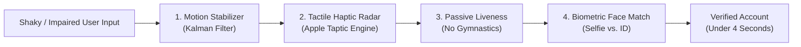
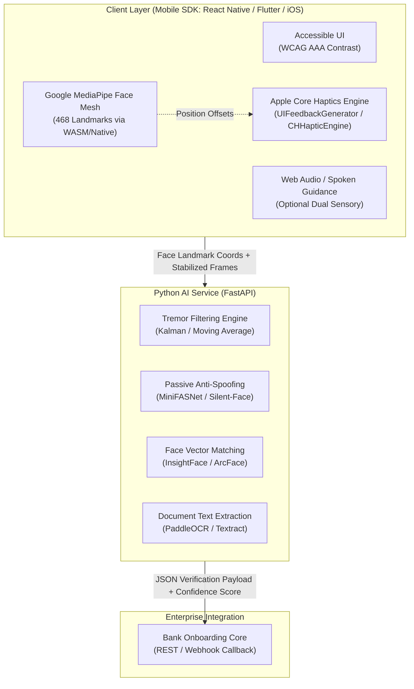
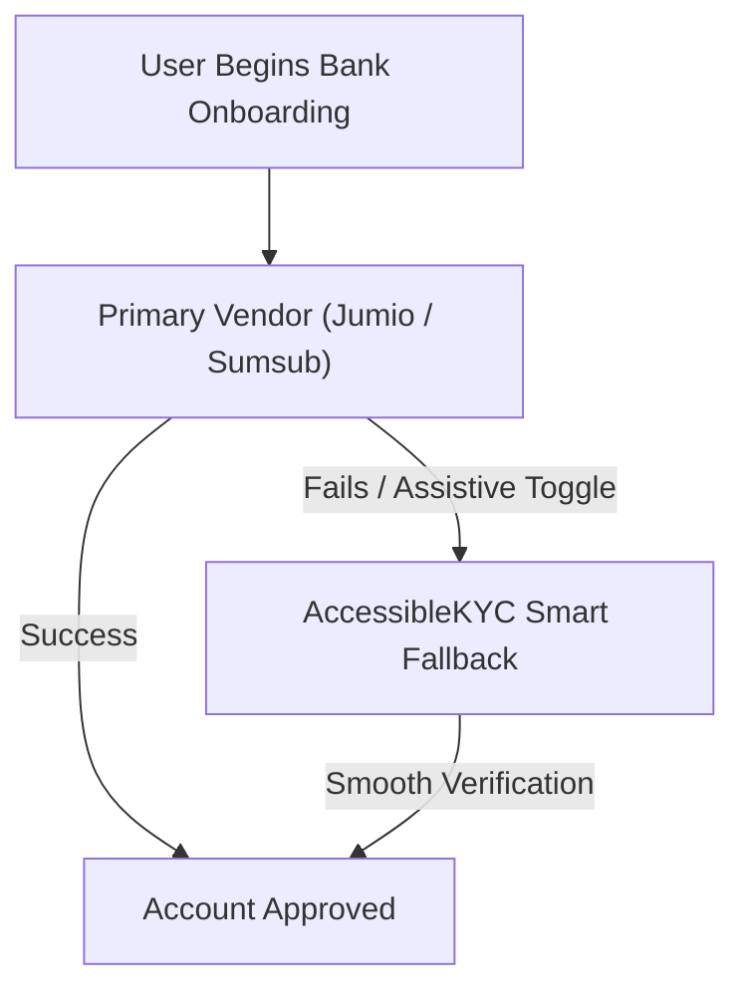

# AccessibleKYC (EquiSign) — Project Blueprint & Specification

> **Tagline:** Making digital identity verification human, dignified, and universally accessible through adaptive vision, tremor stabilization, and tactile haptic radar.

---

## 1. Executive Summary

Digital banking, loan onboarding, and government portals rely heavily on automated "selfie-based" identity verification (eKYC). While convenient for able-bodied users, existing solutions (Jumio, Sumsub, Veriff, Onfido) systematically fail people with physical disabilities, neurological conditions, tremors, and visual impairments.

**AccessibleKYC** is an adaptive, accessibility-first identity verification SDK. It stabilizes camera feeds for users with tremors, replaces rigid "robotic gymnastics" (forced blinking, rapid head turns) with seamless passive anti-spoofing, and introduces a **tactile haptic radar** (using smartphone vibration engines like Apple’s Taptic Engine) alongside audio guidance for blind and low-vision users.

---

## 2. The Problem in Layman's Terms

When a person opens a bank account or applies for a loan on their phone, the app usually demands:
* *"Hold your phone completely still for 5 seconds."*
* *"Blink twice now."*
* *"Turn your head slowly 45° to the left."*

### Who Gets Excluded?
1. **People with Tremors (Parkinson's, Essential Tremor, Severe Anxiety):** Shaky hands cause motion blur, causing the app to timeout or fail.
2. **Stroke Survivors & Facial Palsy (Bell's Palsy, Cerebral Palsy):** Uneven facial movement is flagged by AI models as "face morphing" or "anomalous spoofing."
3. **Blind & Low-Vision Users:** Cannot see the on-screen alignment guidelines. Loud voice instructions in public places compromise their personal financial privacy.
4. **The Elderly:** Struggle with rigid posture holding, small text instructions, and micro-gestures.

**The Business Impact:** Banks silently lose **15% to 20%** of potential accounts, while facing multi-million dollar regulatory penalties under non-discrimination laws.

---

## 3. The Core Solution

### Four Key Pillars:

#### 1. Digital Stabilizer for Tremors
Uses motion-smoothing algorithms (Kalman filters) to mathematically dampen erratic landmark fluctuations so the camera captures clean frames even if the user's hand or head is shaking.

#### 2. Tactile Haptic Radar (Sensory Steering)
Rather than relying solely on screen visuals or loud speakers, the phone communicates directly against the user’s palm using **native smartphone vibration hardware (e.g., Apple Taptic Engine)**:
* **Privacy & Dignity:** Users can verify accounts in public places (bank branches, buses, cafes) without audio announcing their actions to bystanders.
* **Ambient Noise Resilience:** Functions reliably in loud streets or noisy rooms where audio cues get drowned out.
* **The Haptic Vocabulary:**
  * **Searching for Face:** Subtle, slow heartbeat pulse every 1.5 seconds.
  * **Approaching Center (Geiger Counter):** Pulse frequency and intensity increase smoothly as the face centers into the frame.
  * **Drifting Out of Bounds:** Distinct, low-frequency dull buzz (signaling need to adjust angle).
  * **Captured & Verified:** A crisp, satisfying double-tap confirming completion.

#### 3. Zero Robotic Gymnastics (Passive Anti-Spoofing)
Replaces active challenges (*"blink now"*, *"look left"*) with background texture, skin micro-reflectance, and natural micro-movement analysis over a continuous 3-second buffer.

#### 4. Voice & Spatial Audio Assistance
Optional voice prompts (*"Tilt phone slightly up"*) and pitch-based sonification provide a dual-sensory fallback alongside haptics.

---

## 4. System Architecture & Tech Stack

### Tech Stack Breakdown:

| Layer | Technology | Purpose |
|---|---|---|
| **Mobile Client SDK** | React Native / Flutter or Swift (iOS Native) | Cross-platform mobile SDK with full low-level access to phone sensors and haptic motors. |
| **Haptics Engine** | Apple `CoreHaptics` & `UIFeedbackGenerator` | Drives nuanced, high-definition tactile sensations on iPhones with zero extra hardware. |
| **Edge Face Tracking** | Google MediaPipe Face Mesh | 468 3D facial landmarks tracked at 60 FPS directly on the client with zero latency. |
| **Motion Dampening** | Kalman Filter (NumPy / SciPy) | Mathematical smoothing of tremor noise across landmark coordinates over time. |
| **Passive Liveness** | MiniFASNet / Silent-Face-Anti-Spoofing | Evaluates depth, specular reflections, and moiré patterns without requiring user gestures. |
| **Biometric Matcher** | InsightFace (ArcFace) | Generates 512-D embeddings to compute cosine similarity between selfie and ID photo. |
| **Document OCR** | PaddleOCR / Tesseract.js | Extracts ID photo, National ID number, Name, and Date of Birth. |
| **Backend API** | Python (FastAPI) + Docker | High-throughput asynchronous service delivering verification decisions in < 500ms. |

---

## 5. Hardware Integration & Mobile Strategy

### Zero Custom Hardware Required
* **100% Software Solution:** Uses the built-in vibration actuators (Apple Taptic Engine on iPhone, Linear Resonant Actuators on Android) already present in billions of smartphones.
* **No Accessories / Dongles:** Users do not need to buy or carry specialized assistive peripherals.
* **Distribution Advantage:** Readily distributed via an iOS/Android SDK embeddable in any mobile banking app.

### Native vs. Web Note:
* **iOS Native / Flutter / React Native:** Full access to Apple's `CHHapticEngine` and custom vibration waveforms.
* **Mobile Safari (Web):** Apple restricts the web `navigator.vibrate` API inside Safari for security and battery reasons; therefore, **AccessibleKYC is built as a lightweight mobile SDK** (or wrapped via Capacitor/React Native for web applications).

---

## 6. Enterprise Business Case & Startup Potential

### 1. Regulatory "Forced Buying" (The Market Driver)
* **European Accessibility Act (EAA):** Mandatory digital accessibility for all banking and payment services operating in the EU. Non-compliant firms face daily operational fines and license restrictions.
* **ADA Title III (United States):** Over 4,000 digital accessibility lawsuits filed annually against financial institutions.
* **Central Bank Financial Inclusion Mandates:** Global regulators require measurable inclusion targets for persons with disabilities (PWDs).

### 2. The Go-To-Market (GTM): Smart Fallback SDK
Banks do not need to replace their existing \$10M contracts with Jumio or Veriff on Day 1.

* **The Pitch to Banks:** *"Keep your current vendor for 80% of users. Route the 20% who fail due to tremors, visual conditions, or age to AccessibleKYC. Stop losing customers and guarantee full legal compliance."*

### 3. Business & Revenue Model
* **Model:** B2B Usage-Based SaaS.
* **Verification Fee:** **\$0.80 – \$2.00** per successful verification.
* **Platform Retainer:** **\$1,500 – \$5,000/month** enterprise integration & compliance SLA.

---

## 7. Hackathon 48-Hour Demo Execution Plan

### Step 1: The "Split-Screen" Tremor Demo
* **Left Screen (Standard Bank App):** Simulates a user with hand/head tremors attempting standard KYC. The progress bar stalls, then flashes: **"Verification Failed: Motion detected / Timed out."**
* **Right Screen (AccessibleKYC):** The same shaky stream runs through our Kalman filter and passive liveness engine. The green checkmark appears in **3.5 seconds**: **"Identity Verified."**

### Step 2: The "Eyes-Closed Tactile Challenge" (The Winning Wow-Factor)
* Hand an iPhone running the AccessibleKYC prototype to a judge.
* Ask the judge to **close their eyes completely** and hold the phone.
* Guide them strictly through **haptic vibrations**:
  1. The phone pulses faster as they steer towards their face.
  2. A crisp double-tap confirms optimal alignment.
* When they open their eyes and see they successfully verified their identity without looking at the screen once, the value proposition is proven instantly.

---

## 8. Pitch Deck Blueprint (5 Slides to Win)

1. **Slide 1: The Barrier:** Show a short clip of someone with Parkinson's or a visually impaired user failing a mobile banking selfie verification.
2. **Slide 2: The Unseen Exclusion:** 1.3 billion disabled people globally + 1 billion elderly individuals locked out of digital banking by able-bodied biometric models.
3. **Slide 3: The Innovation (Live Demo):** 30-second live demonstration featuring tremor smoothing and the **Eyes-Closed Haptic Radar**.
4. **Slide 4: The Curb-Cut Effect:** Designing for disability solves shaky hands on a moving bus, poor lighting, and cracked cameras for all users.
5. **Slide 5: The Business & Ask:** B2B Smart-Fallback SDK targeting the \$15B Identity Verification market with zero additional hardware required.
