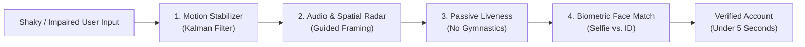
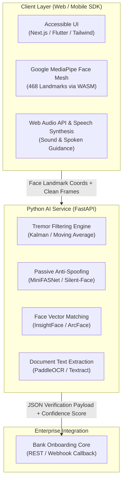
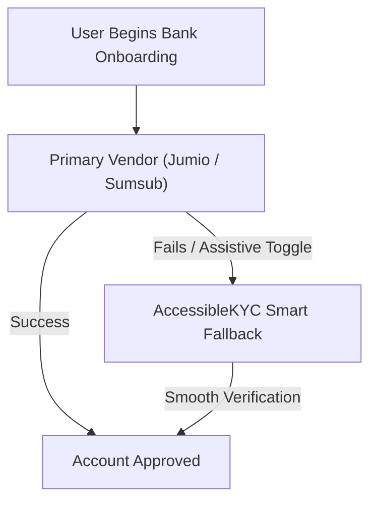

# AccessibleKYC (EquiSign) — Project Blueprint & Specification

> **Tagline:** Making digital identity verification human, dignified, and accessible for everyone—regardless of physical ability or age.

---

## 1. Executive Summary

Digital banking, loan onboarding, and government portals rely heavily on automated "selfie-based" identity verification (eKYC). While convenient for able-bodied users, existing solutions (Jumio, Sumsub, Veriff, Onfido) systematically fail people with physical disabilities, neurological conditions, tremors, and visual impairments.

**AccessibleKYC** is an adaptive, accessibility-first identity verification SDK. It stabilizes camera feeds for users with tremors, replaces rigid "robotic gymnastics" (forced blinking, rapid head turns) with seamless passive anti-spoofing, and provides audio-guided spatial positioning for blind and low-vision users.

---

## 2. The Problem in Layman's Terms

When a person opens a bank account or applies for a loan on their phone, the app usually demands:
* *"Hold your phone completely still for 5 seconds."*
* *"Blink twice now."*
* *"Turn your head slowly 45° to the left."*

### Who Gets Excluded?
1. **People with Tremors (Parkinson's, Essential Tremor, Severe Anxiety):** Shaky hands cause motion blur, causing the app to timeout or fail.
2. **Stroke Survivors & Facial Palsy (Bell's Palsy, Cerebral Palsy):** Uneven facial movement is flagged by AI models as "face morphing" or "anomalous spoofing."
3. **Blind & Low-Vision Users:** Cannot see the tiny on-screen oval or alignment guidelines, leading to framing errors.
4. **The Elderly:** Struggle with rigid posture holding and micro-instructions.

**The Business Impact:** Banks silently lose **15% to 20%** of potential accounts, while facing multi-million dollar regulatory penalties under non-discrimination laws.

---

## 3. The Core Solution

### Three Key Pillars:
1. **Digital Stabilizer for Tremors:** Uses motion-smoothing algorithms (Kalman filters) to stabilize erratic landmark fluctuations so the camera captures clean frames even if the user's hand or head is shaking.
2. **Zero Robotic Gymnastics (Passive Anti-Spoofing):** Replaces active challenges (*"blink now"*, *"look left"*) with background texture, skin micro-reflectance, and natural micro-movement analysis over a continuous 3-second buffer.
3. **Voice & Audio Radar for the Blind:** Voice cues (*"Tilt phone slightly up"*) and audio pitch feedback (pitch rises as the face centers into optimal focus) replace visual-only framing guides.

---

## 4. System Architecture & Tech Stack

### Tech Stack Breakdown:

| Layer | Technology | Purpose |
|---|---|---|
| **Frontend UI** | Next.js 14, TailwindCSS, Web Audio API | WCAG AAA compliant interface with accessible contrast and voice guidance. |
| **Edge Face Tracking** | Google MediaPipe Face Mesh (WASM) | 468 3D facial landmarks tracked at 60 FPS directly in the browser with zero latency. |
| **Motion Dampening** | Kalman Filter (NumPy / SciPy) | Mathematical smoothing of tremor noise across landmark coordinates over time. |
| **Passive Liveness** | MiniFASNet / Silent-Face-Anti-Spoofing | Evaluates depth, specular reflections, and moiré patterns without user actions. |
| **Biometric Matcher** | InsightFace (ArcFace) | Generates 512-D embeddings to compute cosine similarity between selfie and ID photo. |
| **Document OCR** | PaddleOCR / Tesseract.js | Extracts ID photo, National ID number, Name, and Date of Birth. |
| **Backend API** | Python (FastAPI) + Docker | High-throughput asynchronous service delivering verification decisions in < 500ms. |

---

## 5. Enterprise Business Case & Startup Potential

### 1. Regulatory "Forced Buying" (The Market Driver)
* **European Accessibility Act (EAA):** Enforces mandatory digital accessibility for all banking and payment services operating in the EU. Non-compliant firms face daily operational fines and license restrictions.
* **ADA Title III (United States):** Digital accessibility lawsuits against financial institutions exceed 4,000 cases annually.
* **Central Bank Financial Inclusion Mandates:** Global regulators require measurable inclusion targets for persons with disabilities (PWDs).

### 2. The Go-To-Market (GTM): Smart Fallback SDK
Banks do not need to replace their existing \$10M contracts with Jumio or Veriff on Day 1.

* **The Pitch to Banks:** *"Keep your current vendor for 80% of users. Route the 20% who fail due to tremors, visual conditions, or age to AccessibleKYC. Stop losing customers and guarantee full legal compliance."*

### 3. Business & Revenue Model
* **Model:** B2B Usage-Based SaaS.
* **Verification Fee:** **\$0.80 – \$2.00** per successful verification.
* **Platform Retainer:** **\$1,500 – \$5,000/month** enterprise integration & compliance SLA.

---

## 6. Hackathon 48-Hour Demo Execution Plan

### Step 1: The "Split-Screen" Side-by-Side Demo (The Hook)
* **Left Screen (Standard Bank App):** Simulates a user with hand/head tremors attempting standard KYC. The progress bar stalls, then flashes: **"Verification Failed: Motion detected / Timed out."**
* **Right Screen (AccessibleKYC):** The same shaky stream runs through our Kalman filter and passive liveness engine. The green checkmark appears in **3.5 seconds**: **"Identity Verified."**

### Step 2: The "Blindfolded" Audio Demo (The Wow Factor)
* Blindfold a judge or turn the laptop screen away.
* Guide the user strictly through spatial audio tones and voice prompts (*"Tilt up... hold steady..."*).
* Complete the verification successfully with zero visual interaction.

---

## 7. Pitch Deck Blueprint (5 Slides to Win)

1. **Slide 1: The Barrier:** Show a 5-second video of someone with Parkinson's trying and failing to open a mobile bank account.
2. **Slide 2: The Unseen Exclusion:** 1.3 billion disabled people globally + 1 billion elderly individuals locked out of the digital economy.
3. **Slide 3: The Innovation (Live Demo):** 30-second live demonstration of AccessibleKYC stabilizing motion and verifying in real time.
4. **Slide 4: The Curb-Cut Effect:** Designing for tremors also solves bad lighting, bumpy bus rides, and older phone cameras for everyone.
5. **Slide 5: The Business & Ask:** B2B Smart-Fallback SDK targeting the \$15B Identity Verification market.
